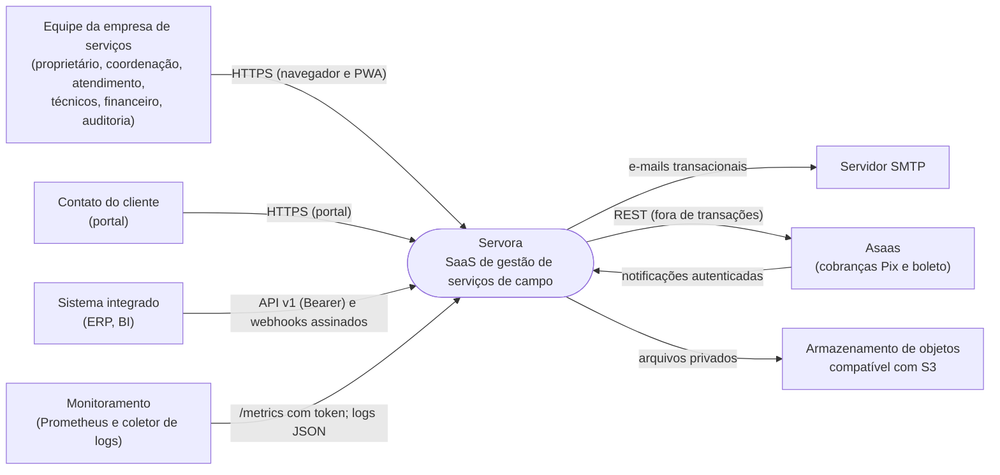
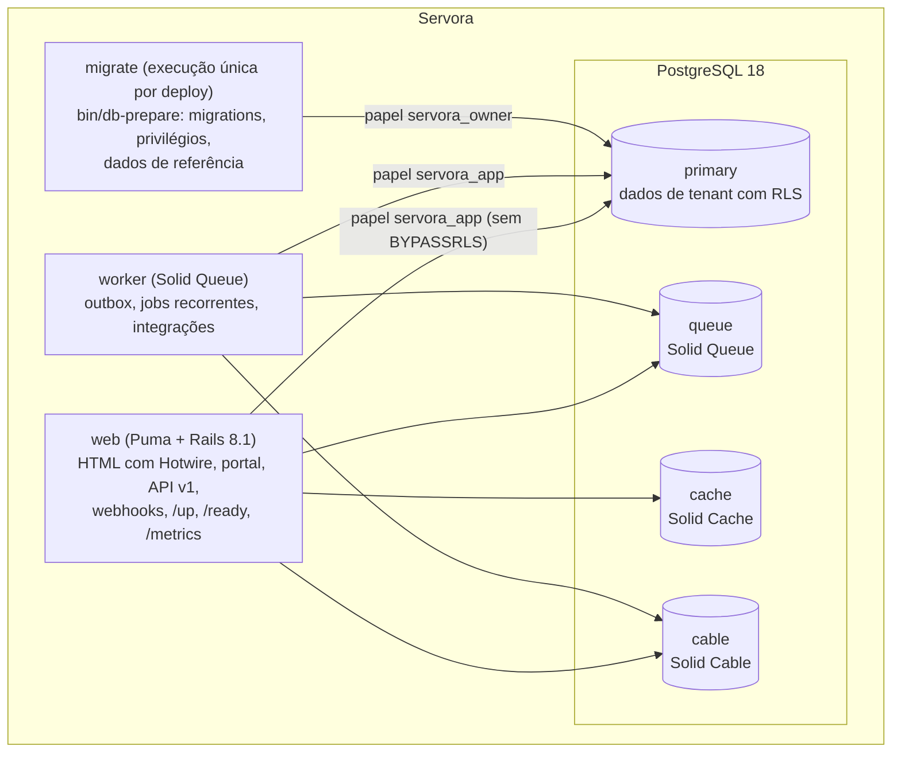

# C4 — Contexto e contêineres

## Contexto

## Contêineres

- `web` e `worker` usam a mesma imagem (multi-stage, usuário não root); migrations nunca rodam nos processos web.
- O contexto de tenant é definido por transação (`set_config(..., true)`) e todas as tabelas de tenant têm RLS.
- Em desenvolvimento o Compose sobe ainda Mailpit e o build contínuo do Tailwind (`css`).
