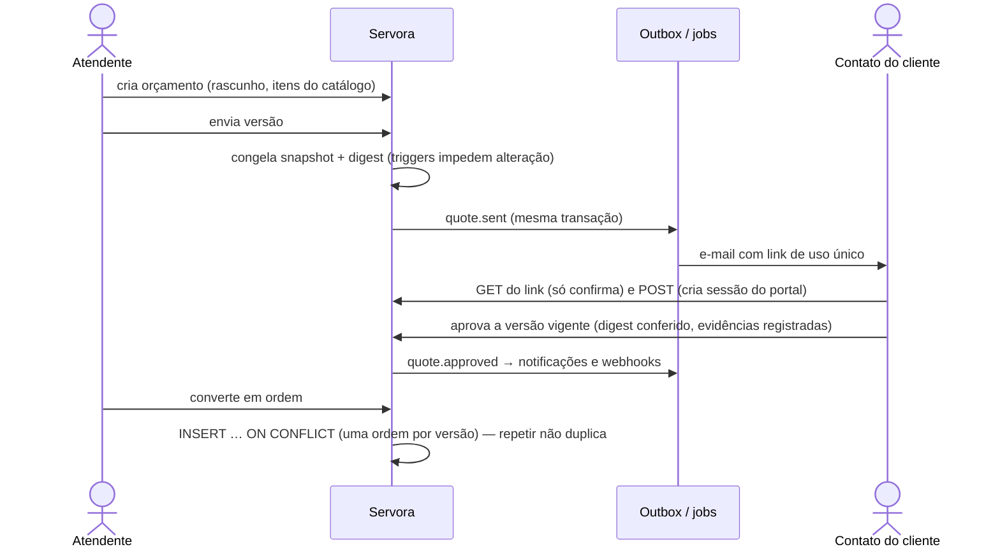
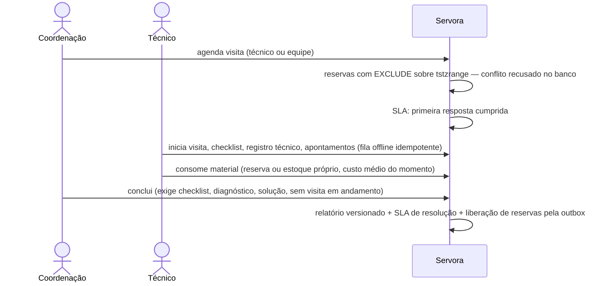
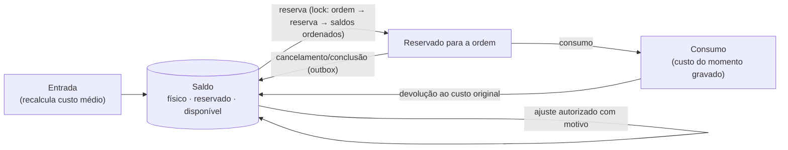
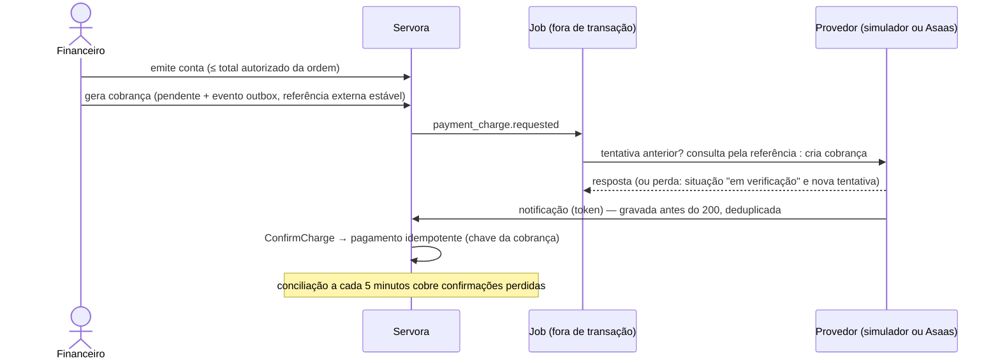

# Fluxos principais

## Orçamento → aprovação → ordem de serviço

## Execução da ordem

## Estoque

Cada alteração de saldo grava um movimento append-only com o saldo resultante; o trigger do banco recusa
qualquer alteração sem movimento novo compatível.

## Contas a receber e cobrança

## Preventiva

1. Contrato vigente com plano (periodicidade, âncora, antecedência).
2. Job diário: para cada plano ativo, trava o plano, calcula as sequências devidas (até 12 por execução) e
   cria ocorrência + ordem por sequência; `(plano, sequência)` único impede duplicidade.
3. Mudança de calendário reancora na próxima sequência; ocorrências geradas não mudam.
