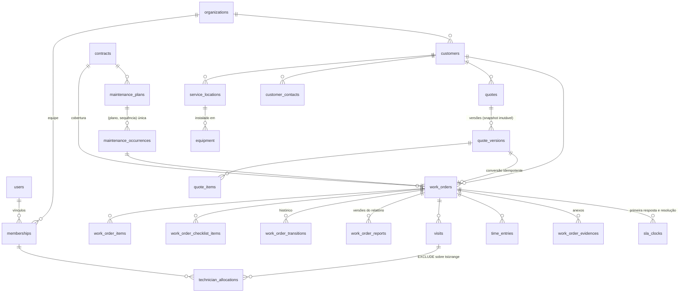
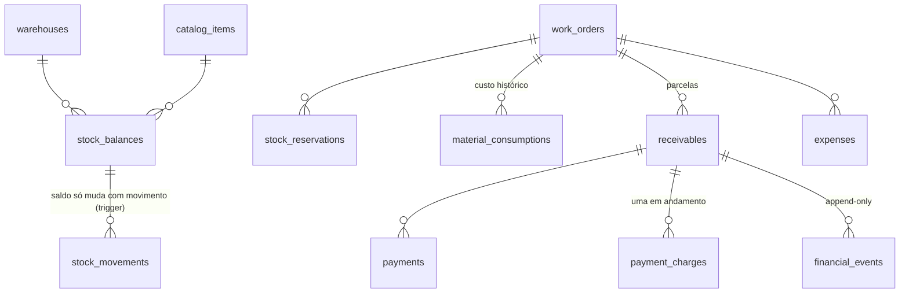

# Modelo de dados

Todas as tabelas de tenant têm `organization_id`, chave `(organization_id, id)`, RLS e chaves estrangeiras
compostas (referências nunca atravessam organizações). Chaves primárias UUIDv7. Valores monetários em
`numeric(14,2)`, quantidades `numeric(14,3)`, custos unitários `numeric(14,4)`. Instantes em `timestamptz`.

## Núcleo operacional

## Estoque e financeiro

## Integrações, plataforma e infraestrutura

| Tabela | Função |
|---|---|
| `outbox_events`, `outbox_event_failures` | Transactional Outbox com lease, retentativas e falhas |
| `notifications` | Notificações internas idempotentes |
| `audit_events` | Auditoria append-only com redação |
| `api_credentials`, `api_idempotency_keys` | Credenciais da API (digest) e respostas idempotentes |
| `webhook_endpoints`, `webhook_deliveries` | Webhooks de saída (segredo criptografado, entrega única por evento) |
| `inbound_webhooks` | Notificações recebidas, deduplicadas pelo id do provedor |
| `field_operations` | Resultado das operações do aplicativo de campo por id |
| `plans`, `plan_modules` | Catálogo da plataforma (somente leitura para a aplicação) |
| `subscriptions` | Assinatura da plataforma por organização |
| `active_storage_*` | Arquivos com `organization_id` atribuído pelo banco e RLS |

Tabelas append-only (UPDATE/DELETE revogados para o papel de aplicação): `audit_events`, `contract_versions`,
`equipment_events`, `financial_events`, `quote_events`, `outbox_event_failures`, `sla_clock_events`,
`stock_movements`, `visit_transitions`, `work_order_reports`, `work_order_transitions`.
